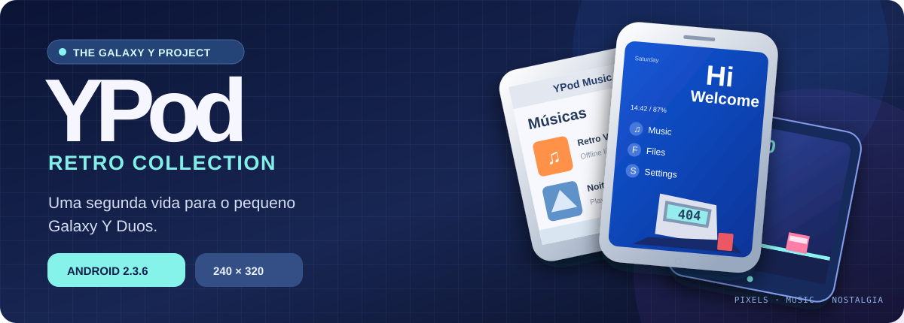
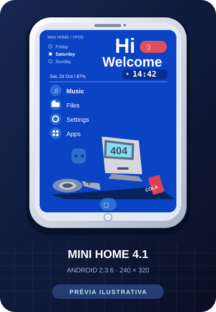
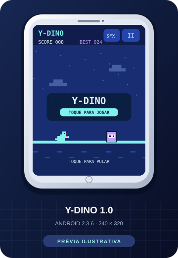
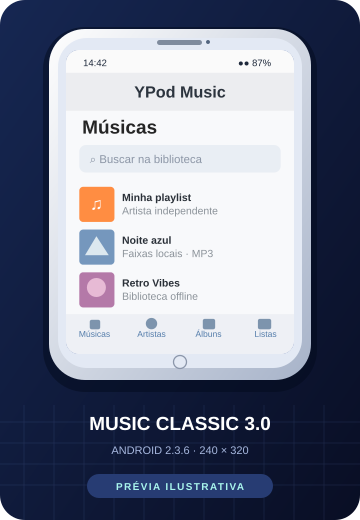
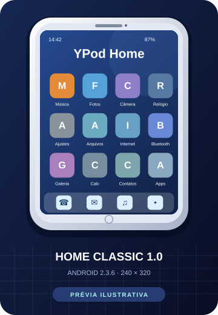

# YPod Midnight 4.0 — música offline para Galaxy Y Duos

Edição feita para **Samsung Galaxy Y Duos GT-S6102B (Android 2.3 / API 10)**. 
Player leve, nativo em Java, sem login, publicidade, assinatura ou conexão de internet.

## O que já funciona

- Interface escura com detalhes rosa, estilo iPod/Apple Music; capas de álbum e mini-player.
- Reprodução local de MP3 e formatos suportados pelo Android 2.3; busca por música, artista e álbum.
- Play, pause, próxima, anterior, barra de progresso, aleatório e repetição.
- Playlists locais: criar, adicionar e remover músicas.
- Motor de áudio em serviço de primeiro plano para continuar tocando com tela bloqueada ou fora do aplicativo.
- Pausa automática ao desconectar o fone e ao perder foco de áudio.
- Separação de identidade do pacote (`com.pocketbeat.ypodmidnight`) para evitar conflito com APKs antigos.

## Instalar no Galaxy Y

1. Vá a [Actions → Build YPod APK](https://github.com/Yoshiizin/YPod/actions/workflows/build-apk.yml) e abra a **última execução com sucesso**.
2. No final da execução, baixe o artefato **YPod-Midnight-APK** e descompacte o ZIP.
3. Copie `app-debug.apk` para o celular e abra pelo gerenciador de arquivos.
4. No Android 2.3, habilite temporariamente **Configurações → Aplicativos → Fontes desconhecidas** para instalar o APK.
5. Coloque suas músicas em **Music** no cartão SD, aguarde o Android indexá-las e, no YPod, abra **Ajustes → Atualizar músicas**.

**Importante:** o APK é assinado para testes pelo GitHub Actions; builds diferentes podem receber certificados diferentes, então novas versões podem exigir desinstalar a anterior antes de instalar. Para distribuição contínua, configure uma chave privada de assinatura estável em GitHub Secrets. O código não contém chaves de assinatura privadas.

---

<p align="center">
  
</p>

<h1 align="center">YPod · Retro Collection</h1>

<p align="center">
  <strong>Uma segunda vida para o Samsung Galaxy Y Duos.</strong><br/>
  Música offline, homes personalizadas e joguinhos retrô para um Android que se recusa a aposentar. 🦖
</p>

<p align="center">
  
  
  
  
</p>

<p align="center">
  <a href="https://github.com/Yoshiizin/YPod/actions/workflows/build-apk.yml"></a>
  <a href="https://github.com/Yoshiizin/YPod/actions/workflows/mini-home-apk.yml"></a>
  <a href="https://github.com/Yoshiizin/YPod/actions/workflows/mini-game-apk.yml"></a>
</p>

<p align="center">
  <a href="#-explore-os-aplicativos">Ver os aplicativos</a> ·
  <a href="#-baixar-e-instalar">Baixar APKs</a> ·
  <a href="#-por-dentro-do-projeto">Código-fonte</a> ·
  <a href="https://github.com/Yoshiizin/YPod/issues">Sugerir melhorias</a>
</p>

---

## ✨ A ideia

O **YPod** é uma coleção de apps experimentais feitos especialmente para o **Samsung Galaxy Y Duos GT-S6102B**, com **Android 2.3.6**, **API 10** e tela de **240 × 320 px**. A proposta é reaproveitar hardware antigo com interfaces caprichadas, pouca memória e o mínimo de dependências possível.

**Sem serviços Google obrigatórios, sem anúncios e sem login nos apps desta coleção.**

> 📸 **Sobre as imagens:** as artes abaixo são **prévias ilustrativas construídas a partir das interfaces e funcionalidades do código**. Ainda não são capturas reais de um Galaxy Y. Os layouts e proporções podem variar no aparelho físico.

## 🎮 Explore os aplicativos

<table>
  <tr>
    <td align="center" width="36%">
      
    </td>
    <td valign="top">
      <h3>💙 YPod Mini Home <code>v4.1</code></h3>
      <p>Uma home azul, minimalista e divertida, inspirada na estética de aparelhos compactos e interfaces japonesas.</p>
      <ul>
        <li>Relógio digital, dia, data e bateria reais</li>
        <li>Atalhos para Música, Arquivos, Configurações e Apps</li>
        <li>Gestos, transições leves e ilustração retrô</li>
        <li>Ícones vetoriais e toque do botão <strong>Music corrigido na v4.1</strong></li>
      </ul>
      <p><a href="./mini-home/"><strong>📂 Ver código</strong></a> · <a href="https://github.com/Yoshiizin/YPod/actions/workflows/mini-home-apk.yml"><strong>⬇️ APK</strong></a></p>
    </td>
  </tr>
  <tr>
    <td align="center">
      
    </td>
    <td valign="top">
      <h3>🦖 Y-Dino <code>v1.0</code></h3>
      <p>Um mini game de corrida infinita para jogar na telinha do Galaxy Y. Simples de entender, difícil de largar.</p>
      <ul>
        <li>Toque para pular fitas cassete e outros obstáculos</li>
        <li>Pontuação crescente e recorde salvo localmente</li>
        <li>Efeitos sonoros opcionais e botão de pausa</li>
        <li>Pixel art gerada com Canvas, sem internet</li>
      </ul>
      <p><a href="./mini-game/"><strong>📂 Ver código</strong></a> · <a href="https://github.com/Yoshiizin/YPod/actions/workflows/mini-game-apk.yml"><strong>⬇️ APK</strong></a></p>
    </td>
  </tr>
  <tr>
    <td align="center">
      
    </td>
    <td valign="top">
      <h3>🎵 YPod Music Classic <code>v3.0</code></h3>
      <p>Um player local inspirado nos reprodutores de música clássicos, com foco no que interessa: suas próprias músicas.</p>
      <ul>
        <li>Biblioteca MP3 com músicas, artistas e álbuns</li>
        <li>Playlists locais, busca e arte de álbum</li>
        <li>Controles de reprodução, shuffle e repeat</li>
        <li>Compatível com uso completamente offline</li>
      </ul>
      <p><a href="./app/"><strong>📂 Ver código</strong></a> · <a href="https://github.com/Yoshiizin/YPod/actions/workflows/build-apk.yml"><strong>⬇️ APK</strong></a></p>
    </td>
  </tr>
  <tr>
    <td align="center">
      
    </td>
    <td valign="top">
      <h3>📱 YPod Home Classic <code>v1.0</code></h3>
      <p>Outra proposta de home, com grade de ícones, atalhos rápidos e aquela sensação de celular dos anos 2010.</p>
      <ul>
        <li>Launcher independente com grade e dock</li>
        <li>Atalhos para apps do aparelho</li>
        <li>Visual clássico com cores personalizáveis</li>
      </ul>
      <p><a href="./home/"><strong>📂 Ver código</strong></a> · <a href="https://github.com/Yoshiizin/YPod/actions/workflows/build-apk.yml"><strong>⬇️ APK</strong></a></p>
    </td>
  </tr>
</table>

## 📦 Baixar e instalar

Os APKs são gerados automaticamente no **GitHub Actions**. Não é necessário instalar Android Studio ou compilar nada para testar no celular.

| Aplicativo | Build | Arquivo a extrair do ZIP |
| :--- | :--- | :--- |
| YPod Mini Home 4.1 | [Baixar na página de builds](https://github.com/Yoshiizin/YPod/actions/workflows/mini-home-apk.yml) | `YPod-Mini-Home-Galaxy-Y.apk` |
| Y-Dino 1.0 | [Baixar na página de builds](https://github.com/Yoshiizin/YPod/actions/workflows/mini-game-apk.yml) | `YPod-Y-Dino-Galaxy-Y.apk` |
| YPod Music Classic 3.0 | [Baixar na página de builds](https://github.com/Yoshiizin/YPod/actions/workflows/build-apk.yml) | `app-debug.apk` |
| YPod Home Classic 1.0 | [Baixar na página de builds](https://github.com/Yoshiizin/YPod/actions/workflows/build-apk.yml) | `home-debug.apk` |

**Como instalar:** abra o build mais recente marcado como **Success** → em **Artifacts**, baixe o ZIP → **extraia o APK** → transfira para o Galaxy Y → ative **Configurações → Aplicativos → Fontes desconhecidas** → abra o APK pelo gerenciador de arquivos.

Depois, para usar a Mini Home, pressione o botão físico **Home** e selecione **YPod Mini Home 4.1**. Segure o atalho **Music** para escolher seu player; o **Y-Dino** ficará disponível no menu de apps. Dependendo das permissões do GitHub, é necessário fazer login para baixar os Artifacts.

> ⚠️ **Importante:** o ZIP baixado do Actions não é ROM, e **não deve ser instalado pelo Odin ou recovery**. Estes são aplicativos Android. Para instalar sem perder dados em atualizações futuras, é necessária uma **chave de assinatura privada e persistente**: os builds atuais podem usar chaves diferentes e exigir reinstalação. Desinstalar o Y-Dino apaga seu recorde local.

## 🧰 Por dentro do projeto

```text
YPod/
├── app/                # YPod Music Classic 3.0
├── home/               # YPod Home Classic 1.0
├── mini-home/          # YPod Mini Home Dynamic 4.1
├── mini-game/          # Y-Dino 1.0
├── docs/showcase/      # Capa e prévias ilustrativas
└── .github/workflows/  # Compilação de todos os APKs
```

| Tecnologia | Escolha |
| :--- | :--- |
| Dispositivo-alvo | Samsung Galaxy Y Duos **GT-S6102B** |
| Sistema-alvo | **Android 2.3.6 / API 10** |
| Resolução de referência | **240 × 320**, modo retrato |
| Linguagem | **Java** e Android SDK |
| Mini Home e Y-Dino | Renderização por **Canvas** sem bibliotecas modernas |
| Compilação | **GitHub Actions** (Gradle para os apps clássicos; build direto com SDK para Mini Home e jogo) |
| Rede | **Não exigida** pelos aplicativos |

### 🗓️ Histórico de versões

| App | Atualização |
| :--- | :--- |
| Mini Home **v4.1** | Correção do toque de Music e áreas interativas separadas do relógio |
| Mini Home **v4.0** | Relógio digital na home, com expansão ao toque |
| Mini Home **v3.x** | Gestos, transições e controles leves |
| Mini Home **v2.0** | Ícones desenhados em Canvas para evitar símbolos quebrados no Gingerbread |
| Mini Home **v1.0** | Primeira home azul com atalhos |
| Y-Dino **v1.0** | Corrida arcade, pontuação, recorde e áudio opcional |
| Music Classic **v3.0** | Player local, navegação por biblioteca e playlists |
| Home Classic **v1.0** | Launcher clássico independente |

## ⚖️ Licença e direitos

O código original é distribuído sob a **[Licença MIT](./LICENSE)**. Ela permite usar, modificar e redistribuir o código mediante preservação do aviso de copyright e licença, inclusive em projetos comerciais. O uso de **marcas de terceiros, logos, firmwares Samsung, conteúdo de usuários e componentes com outras licenças** não é autorizado por esta licença. Leia os [avisos sobre terceiros](./THIRD_PARTY_NOTICES.md).

A licença **não garante imunidade a processos**. Antes de distribuir uma ROM, som ou arte de origem externa, é necessário verificar sua autorização.

## 🧪 Status e limitações

Os APKs têm **compilações aprovadas no GitHub Actions**, mas isso **não equivale a testes completos no dispositivo real**. Algumas funções, áudio e desempenho precisam ser verificados no Galaxy Y físico. A Mini Home **não substitui o Android** e nenhum ZIP deste repositório é uma ROM flashável.

Para sugerir uma função ou relatar um bug, use [Issues](https://github.com/Yoshiizin/YPod/issues) e informe **modelo do aparelho, versão instalada, comportamento esperado e comportamento observado**. Se tiver uma captura real, anexe-a sem dados pessoais. Veja também [Como contribuir](./CONTRIBUTING.md).

---

<p align="center"><strong>Feito para caber em 240 × 320 — e ainda ter personalidade.</strong> ✨</p>
<p align="center"><sub>YPod é um projeto independente de experimentação e nostalgia. Não possui vínculo com Apple, Samsung ou BALMUDA.</sub></p>
